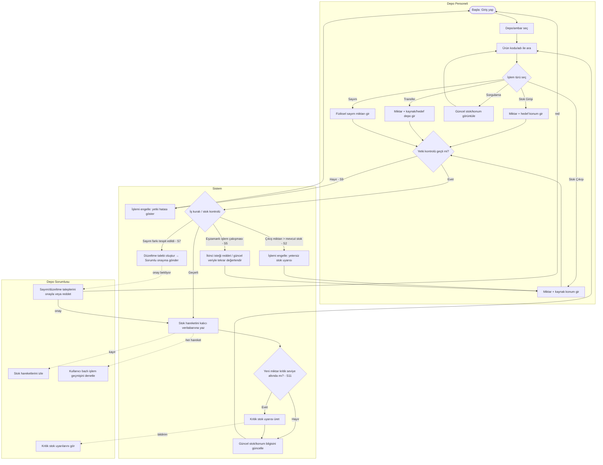

# 2. İş Akış Diyagramı (Workflow Diagram)

> Roller: **Depo Personeli**, **Sistem**, **Depo Sorumlusu**. Ana akış (yeşil/varsayılan yol) ile seçilen kritik kötü durumlar (S2, S5, S7, S9, S11 — bkz. `01-gereksinim-analizi.md`) aynı yapı içinde gösterilmiştir.

## Notlar

- **S9 (yetkisiz erişim):** Yetki kontrolü, ürün/konuma erişmeden önce en ilk adımda yapılır — engellenen kullanıcı hiçbir stok verisini değiştiremez.
- **S2 (yetersiz stok):** İş kuralı kontrolü veritabanı/sunucu tarafında yapılır, yalnızca arayüzde değil.
- **S5 (eşzamanlılık):** İkinci istek, ilkinin işlenmesinden sonra güncel stok değeriyle yeniden değerlendirilir; bu nedenle B2 adımı atomik bir veritabanı işlemi (transaction) içinde çalışmalıdır.
- **S7 (sayım farkı):** Otomatik stok güncellemesi yapılmaz; Depo Sorumlusu onayı akışa dahildir (C3).
- **S11 (kritik seviye):** İşlemi engellemez, yalnızca Depo Sorumlusu'na bildirim üretir.
- Her stok hareketi (B3), rolünden bağımsız olarak Depo Sorumlusu'nun izleyebileceği geçmişe (C4) otomatik olarak düşer.
