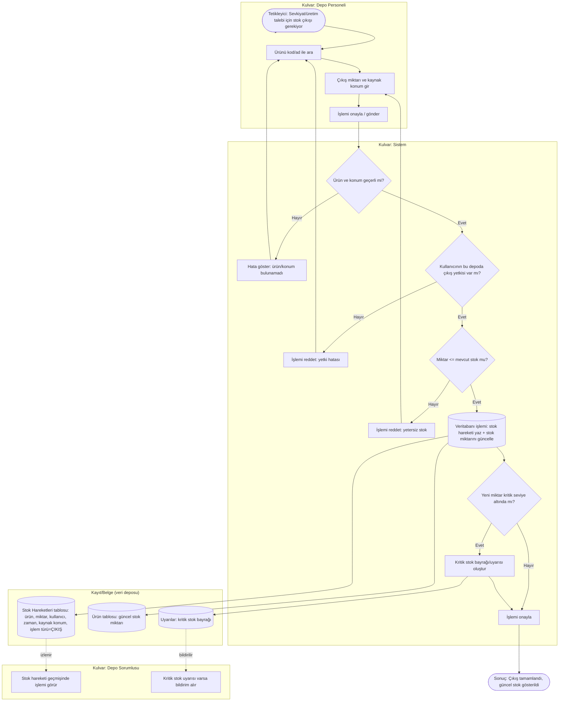

# 3. Süreç Akış Diyagramı — Stok Çıkışı (uçtan uca kritik süreç)

> Kulvarlar: **Depo Personeli** (süreç) · **Sistem** (süreç/kontrol) · **Depo Sorumlusu** (sorumlu/onay) · **Kayıt/Belge** (veri deposu). Tetikleyiciler, karar noktaları, kayıtlar ve sonuçlar belirtilmiştir.

## Süreç Özeti (madde madde)

| Adım | Tetikleyici / Girdi | Karar Noktası | Belge/Kayıt | Sorumlu | Sonuç |
|---|---|---|---|---|---|
| 1 | Sevkiyat/üretim ihtiyacı | — | — | Depo Personeli | Ürün aranır |
| 2 | Ürün + miktar girişi | Ürün/konum geçerli mi? | — | Sistem | Geçersizse engellenir (S1 senaryosu) |
| 3 | Yetki kontrolü | Kullanıcının yetkisi var mı? | — | Sistem | Yetkisizse engellenir (S9 senaryosu) |
| 4 | Stok kontrolü | Miktar ≤ mevcut stok mu? | — | Sistem | Yetersizse engellenir (S2 senaryosu) |
| 5 | Onaylanan çıkış | — | Stok Hareketleri kaydı yazılır (atomik) | Sistem | Stok miktarı güncellenir |
| 6 | Güncellenmiş miktar | Kritik seviyenin altında mı? | Uyarı bayrağı oluşturulur | Sistem | Depo Sorumlusu bilgilendirilir (S11 senaryosu) |
| 7 | Tamamlanan işlem | — | Geçmiş kaydı | Depo Sorumlusu | İzlenebilirlik sağlanır |

## Notlar

- Adım 2–4 arasındaki tüm kontroller **tek bir atomik veritabanı işlemi (transaction)** içinde yapılmalıdır; aksi halde S5 (eşzamanlılık) senaryosunda iki kullanıcı aynı anda geçerli kontrolü geçip negatif stok oluşturabilir.
- "Kayıt/Belge" kulvarındaki Stok Hareketleri tablosu **append-only** mantıkla çalışır: geçmiş hareketler silinmez/değiştirilmez, yalnızca yeni ters hareketlerle düzeltilir (bkz. İK2, `01-gereksinim-analizi.md`).
- Bu süreç, Stok Girişi ve Transfer süreçleri için de aynı iskelet (ara + doğrula + yetki/iş kuralı kontrolü + kalıcı kayıt + uyarı) ile uyarlanacaktır; aralarındaki fark yalnızca kontrol yönü (giriş: stok artar / çıkış: stok kontrollü azalır / transfer: iki konum birlikte güncellenir) ve ek durum alanlarıdır (örn. transferde "beklemede/teslim alındı" durumu — S8 senaryosu).
