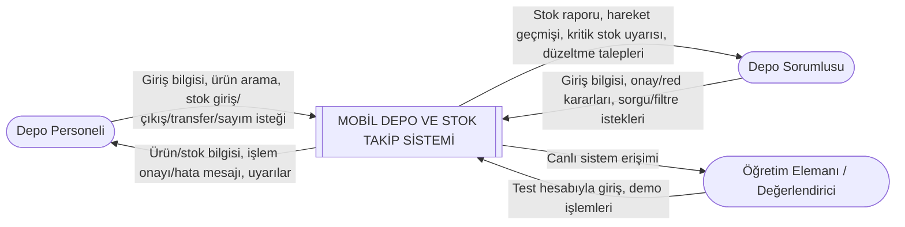
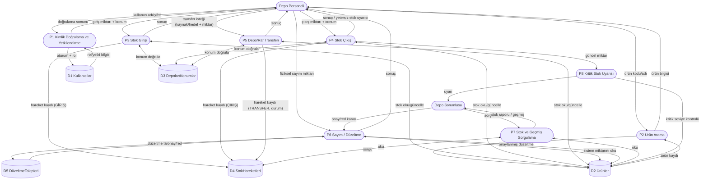
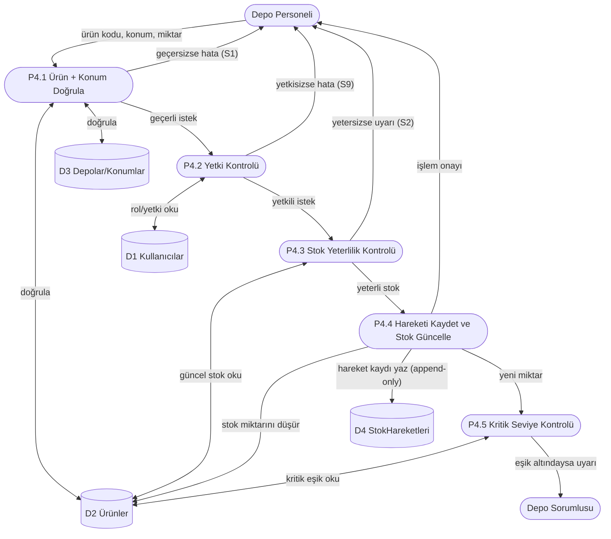

# 4. Veri Akış Diyagramı (DFD)

## 4.1 Bağlam Diyagramı (Context Diagram)

Sistem sınırı ve dış varlıklar:

## 4.2 Seviye-0 DFD (Ana Süreçler)

**Veri depoları:** D1 Kullanıcılar · D2 Ürünler · D3 Depolar/Konumlar · D4 StokHareketleri · D5 DüzeltmeTalepleri (sayım farkları)

## 4.3 Seviye-1 DFD — P4 Stok Çıkışı (ayrıntılandırma)

## 4.4 Notlar / İzlenebilirlik

- P1–P8 süreçleri, `01-gereksinim-analizi.md` içindeki İG1–İG12 ile birebir eşleşir (örn. P4 ↔ İG5, P8 ↔ İG10, P6 ↔ İG11).
- D4 (StokHareketleri) veri deposu **append-only**'dir; bu kural İK2 ile tutarlıdır.
- Seviye-1 ayrıntısındaki P4.1–P4.3 sırası, `03-surec-akis-diyagrami.md`'deki Stok Çıkışı sürecinin S1→S2→S3 karar noktalarıyla aynıdır — böylece gereksinim → senaryo → süreç → veri akışı arasında izlenebilirlik korunur.
