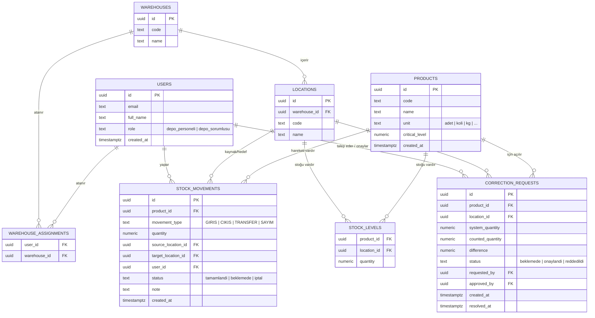

# 5. Veri Modeli

> ⚠️ Bu veri modeli, gereksinimlerden (`01-gereksinim-analizi.md`) ve DFD'deki veri depolarından (`04-veri-akis-diyagrami.md`: D1–D5) türetilmiştir. Supabase şeması kurulurken **AI'ya "bana bir stok takip şeması öner" denmeyecek** — doğrudan bu modeldeki tablo/alan/ilişki yapısı uygulanacaktır (bkz. checklist C.3).

## 5.1 Varlık-İlişki Diyagramı

## 5.2 Tablo Açıklamaları

### USERS
Giriş yapan kullanıcılar ve rolleri. `role` yalnızca iki değer alır: `depo_personeli`, `depo_sorumlusu` (İG2). Supabase kullanılıyorsa bu tablo `auth.users` ile `id` üzerinden eşlenir (bire bir).

### WAREHOUSES
Depo/ambar tanımları. (V1)

### LOCATIONS
Bir depoya ait raf/konum. `warehouse_id` → WAREHOUSES. (V1)

### WAREHOUSE_ASSIGNMENTS
Depo Personeli'nin hangi depo(lar)da işlem yapma yetkisi olduğunu tutan çok-çoğa ilişki tablosu. Birincil anahtar: (`user_id`, `warehouse_id`) bileşik anahtarı. Depo Sorumlusu rolündeki kullanıcılar için bu tablo kontrol edilmez (tüm depolara erişimi vardır — V3).

### PRODUCTS
Ürün kartı. `unit` alanı üründe **sabittir** ve değiştirilemez (S10 kuralı / İK4). `critical_level`: kritik stok uyarı eşiği (İG10).

### STOCK_LEVELS
Bir ürünün bir konumdaki **güncel** miktarı. Birincil anahtar: (`product_id`, `location_id`) bileşik anahtarı. `quantity >= 0` bütünlük kısıtı (İK1) — bu tablo doğrudan güncellenmez, yalnızca STOCK_MOVEMENTS kaydı yazılırken birlikte (aynı transaction içinde) güncellenir.

### STOCK_MOVEMENTS
**Append-only** hareket geçmişi (İK2) — hiçbir kayıt UPDATE/DELETE ile değiştirilmez, yalnızca ters hareketle düzeltilir. `movement_type`:
- `GIRIS`: `target_location_id` dolu, `source_location_id` NULL
- `CIKIS`: `source_location_id` dolu, `target_location_id` NULL
- `TRANSFER`: her ikisi de dolu; `status` = `beklemede` (gönderildi) → `tamamlandi` (teslim alındı) veya `iptal` (S8 senaryosu)
- `SAYIM`: sayım sırasında oluşan ham kayıt; asıl düzeltme CORRECTION_REQUESTS üzerinden yürür

Bütünlük kısıtı: `quantity > 0`.

### CORRECTION_REQUESTS
Sayım farkı tespit edildiğinde oluşan onay bekleyen talep (S7 senaryosu / İG11). `difference = counted_quantity - system_quantity`. `status = beklemede` iken STOCK_LEVELS **değişmez**; `onaylandi` olduğunda STOCK_LEVELS güncellenir ve karşılık gelen bir STOCK_MOVEMENTS kaydı (`movement_type = SAYIM`) yazılır. `approved_by` yalnızca `role = depo_sorumlusu` olan bir kullanıcı olabilir (İK3, İK5).

## 5.3 Birincil Anahtarlar, Çokluklar ve Bütünlük Kuralları (özet)

| Kural | Açıklama |
|---|---|
| PK | Her tabloda `uuid id` (STOCK_LEVELS ve WAREHOUSE_ASSIGNMENTS hariç — onlar bileşik PK kullanır) |
| 1–N | WAREHOUSES → LOCATIONS, PRODUCTS → STOCK_MOVEMENTS, USERS → STOCK_MOVEMENTS |
| N–M | USERS ↔ WAREHOUSES (WAREHOUSE_ASSIGNMENTS üzerinden) |
| Bütünlük 1 | STOCK_LEVELS.quantity >= 0 (negatif stok asla oluşmaz — İK1) |
| Bütünlük 2 | STOCK_MOVEMENTS satırları değiştirilemez/silinemez (append-only — İK2) |
| Bütünlük 3 | PRODUCTS.unit tüm hareketlerde sabittir, hareket bazında değiştirilemez (İK4) |
| Bütünlük 4 | CORRECTION_REQUESTS onaylanmadan STOCK_LEVELS değişmez (İK5) |
| Bütünlük 5 | WAREHOUSE_ASSIGNMENTS'ta olmayan bir depoda `depo_personeli` rolü hareket oluşturamaz (RLS ile zorunlu kılınacak — İOG3) |

## 5.4 Not

Bu model hazır bir şablondan kopyalanmamıştır; doğrudan Bölüm 1 (gereksinimler/senaryolar) ve Bölüm 4 (DFD veri depoları D1–D5) ile birebir türetilmiştir — izlenebilirlik: İG/İK → D1–D5 → bu tablolar.
