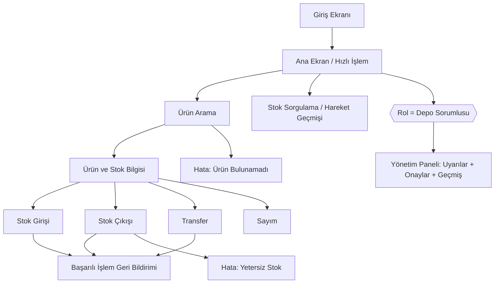

# 6. UX/UI Çalışmaları

> Mobil ekran genişliği (≈375px) hedeflenmiştir. Taslaklar low-fi'dir; gerçek uygulamada bileşen kütüphanesi (örn. shadcn/Tailwind) ile üretilecektir. Her ekran, `01-gereksinim-analizi.md`'deki İG kodlarına referans verir.

## 6.1 Ekran Haritası (Navigasyon)



## 6.2 Giriş / Kullanıcı Doğrulama (İG1)

```
┌─────────────────────────┐
│   Depo Stok Takip        │
│                          │
│  E-posta / Kullanıcı     │
│  [______________________]│
│  Şifre                  │
│  [______________________]│
│                          │
│      [ Giriş Yap ]      │
│                          │
└─────────────────────────┘
```
- Başarısız girişte: "Kullanıcı adı veya şifre hatalı" (hata durumu 1).

## 6.3 Ana Ekran / Hızlı İşlem Seçimi (İG2)

```
┌─────────────────────────┐
│ Merhaba, {ad}  [Çıkış]  │
│ Rol: Depo Personeli     │
├─────────────────────────┤
│ [ Ürün Ara ]            │
│ [ Stok Girişi ]         │
│ [ Stok Çıkışı ]         │
│ [ Transfer ]            │
│ [ Sayım ]               │
│ [ Stok Sorgula ]        │
└─────────────────────────┘
```
- `Depo Sorumlusu` girişinde ek buton: **[ Yönetim Paneli ]** (rol bazlı görünürlük — İG2, İK3).

## 6.4 Ürün Arama (İG3)

```
┌─────────────────────────┐
│ ← Ürün Ara               │
│ [ Kod veya ad ara... 🔍] │
├─────────────────────────┤
│ ▸ P-1001  Vida M6 (Koli)│
│ ▸ P-1002  Saç Levha(Kg) │
│ ▸ ...                   │
└─────────────────────────┘
```
- Sonuç yoksa (S1): "Ürün bulunamadı. Kodu/adı kontrol edin." + arama kutusu odakta kalır (hata durumu 2).

## 6.5 Ürün ve Stok Bilgisi

```
┌─────────────────────────┐
│ ← P-1001 Vida M6          │
│ Birim: Koli               │
│ Kritik Seviye: 20          │
├─────────────────────────┤
│ Depo A / Raf 3 → 45 Koli │
│ Depo B / Raf 1 → 12 Koli ⚠│
├─────────────────────────┤
│ [Giriş] [Çıkış] [Transfer]│
└─────────────────────────┘
```
- `⚠` kritik seviye altı uyarı rozeti (İG10).

## 6.6 Stok Girişi / Çıkışı Ekranları (İG4, İG5)

```
┌─────────────────────────┐
│ ← Stok Çıkışı — P-1001    │
│ Konum: Depo A / Raf 3     │
│ Mevcut: 45 Koli            │
│ Miktar: [______] Koli     │
│ Not (opsiyonel): [______] │
│      [ Onayla ]           │
└─────────────────────────┘
```
- **Hata durumu (S2):** Miktar mevcuttan fazlaysa buton basılı iken: "Yetersiz stok: mevcut 45, girilen 60" — kırmızı banner, işlem gönderilmez.
- **Başarılı geri bildirim:** "✅ Stok çıkışı kaydedildi. Yeni miktar: 30 Koli" + 2 saniye sonra Ürün Bilgisi ekranına döner.
- Giriş ekranı birebir aynıdır, yalnızca "Hedef konum" alanı ve toplama işlemi farklıdır.

## 6.7 Transfer Ekranı (İG6)

```
┌─────────────────────────┐
│ ← Transfer — P-1001        │
│ Kaynak: Depo A / Raf 3    │
│ Hedef:  [Depo seç ▾]      │
│ Miktar: [______] Koli     │
│      [ Transferi Başlat ] │
└─────────────────────────┘
```
- Gönderildikten sonra durum: "Beklemede — hedef depo teslim almadı" (S8) → Depo Sorumlusu panelinde görünür.

## 6.8 Stok Sorgulama / Hareket Geçmişi (İG7, İG9)

```
┌─────────────────────────┐
│ ← Hareket Geçmişi         │
│ Filtre: [Ürün][Depo][Kul.]│
├─────────────────────────┤
│ 19.11 14:02 Çıkış -5 Koli │
│   P-1001, Ekin K.         │
│ 19.11 13:40 Giriş +20 Koli│
│   P-1002, Ahmet Y.        │
└─────────────────────────┘
```

## 6.9 Yönetim Paneli (Depo Sorumlusu — İG9, İG10, İG11)

```
┌─────────────────────────┐
│ Yönetim Paneli            │
│ ⚠ Kritik Stok (3)         │
│ ⏳ Bekleyen Düzeltme (2)   │
│ ⏳ Bekleyen Transfer (1)   │
│      [ Hareket Geçmişi ] │
└─────────────────────────┘
```
- Düzeltme talebi detayında: "[ Onayla ] [ Reddet ]" (S7 / İK5).

## 6.10 Hata/Uyarı ve Başarı Durumları (özet — en az 2 hata + 1 başarı kapsandı)

| Durum | Ekran | Mesaj |
|---|---|---|
| Hata 1 | Giriş | "Kullanıcı adı veya şifre hatalı" |
| Hata 2 | Ürün Arama | "Ürün bulunamadı. Kodu/adı kontrol edin." |
| Hata 3 | Stok Çıkışı | "Yetersiz stok: mevcut X, girilen Y" |
| Hata 4 | Herhangi bir işlem | "Bu işlem için yetkiniz yok" (S9) |
| Başarı | Giriş/Çıkış/Transfer | "✅ İşlem kaydedildi. Yeni miktar: X" |

## 6.11 İleri Özellik Notu

Barkod/QR okutma, çevrimdışı çalışma, bildirim gibi ileri özellikler bu ekran setine **sonradan** eklenecek şekilde tasarlanmıştır (örn. Ürün Arama ekranında arama kutusunun yanına bir kamera ikonu eklenebilir) — ancak checklist madde A'daki tasarım önceliğine göre bunlar çekirdek ekranlar çalışmadan ele alınmayacaktır.
